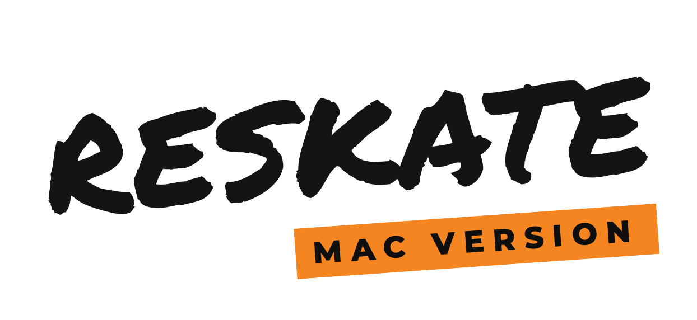

<p align="center">
  <picture>
    <source media="(prefers-color-scheme: dark)" srcset="docs/wordmark-dark.png">
    
  </picture>
</p>

<h3 align="center">Unofficial macOS launcher for ReSkate</h3>

<p align="center">
  <a href="../../releases">Download</a> ·
  <a href="#build-from-source">Build from source</a> ·
  <a href="THIRD_PARTY_NOTICES.md">Third-party notices</a>
</p>

---

A native macOS launcher that installs and runs [ReSkate](https://github.com/Dingo-Shenanigans/ReSkate) for skate. on Apple Silicon Macs. It uses Wine and Apple's Game Porting Toolkit. One click sets everything up, and after that it's the launcher you start the game from.

> **Unofficial.** This project is not affiliated with or endorsed by the ReSkate developers (Dingo-Shenanigans), Electronic Arts / Full Circle, GameSir (GameHub), Apple or Valve. For ReSkate issues on Windows, use the ReSkate project. For anything Mac-specific, open an issue here.

## What it does

On first launch the app installs, with live progress:

1. **Rosetta 2**, if missing (macOS asks for your password).
2. **Wine 11**: GameHub's Proton-based macOS build.
3. **Apple Game Porting Toolkit 4.0-2**, which runs DirectX 12 on Metal.
4. **ReSkate**: the latest release from GitHub, or an existing ReSkate folder you pick.
5. **A Windows environment** (Wine prefix) with the fixes below already applied.
6. **Windows Steam** inside that prefix. ReSkate multiplayer uses Steam lobbies. Sign in once (QR code works); after that Steam runs hidden in the background.

Afterwards it's a launcher: **PLAY** starts Steam in the background and then the ReSkate launcher. Use the ReSkate launcher's Steam download to install the game itself (~16 GB). The first start compiles shaders for a few minutes.

Everything lives in `~/Library/Application Support/ReSkate/`, and the game folder defaults to `~/Games/ReSkate`. If GameHub is already installed, Wine and GPTK are copied from it instead of downloaded.

### Fixes applied automatically

| Problem | Fix |
|---|---|
| Steam never shows its window; `steamwebhelper` hits a stack overflow in an endless font-init recursion | GameHub's Wine leaves `C:\windows\Fonts` empty while the registry points there. The app copies Wine's fonts in. |
| DualShock 4 over Bluetooth is detected but gives no input | `winebus` `DisableHidraw=1`: the game uses the SDL/XInput device instead of raw Bluetooth HID. |
| Wrong scaling on Retina displays | `RetinaMode=N`, `LogPixels=96` |

## ReSkate Studio (optional)

The launcher can also install and open **ReSkate Studio**, the community tool for making maps and cosmetic mods (`.fbmod`).

ReSkate Studio has no public download. It's shared on the ReSkate Discord as `ReSkate_Studio.zip`, so the launcher doesn't download it, you pick the zip yourself. An extracted folder or an installer `.exe` works too.

- **First install:** turn on **ReSkate Studio (optional)** before clicking INSTALL and pick the zip.
- **Later:** click **STUDIO** on the main screen and pick the zip.

Studio goes into the same Windows environment as the game and Steam, so it sees your ReSkate install and its own Launch button works. The launcher:

- copies Studio to `C:\ReSkate Studio`, or runs its installer if the zip contains one;
- checks which .NET runtime the Studio exe needs and installs it from Microsoft: .NET Framework 4.8 (set up the way winetricks does it, replacing Wine Mono), or the matching .NET Desktop Runtime;
- maps your ReSkate folder to drive **R:** and opens Studio with it already selected (`--game R:\`), so Build & Deploy writes straight into your game.

After that, **STUDIO** opens it. TOOLS → Update Studio… copies a newer zip over the old files, so your settings and projects stay. WPF runs with software rendering under Wine, which is reliable but slower than on Windows.

## ReShade (optional)

Turn on **ReShade** before INSTALL, or later under TOOLS → ReShade. The launcher downloads ReShade (checked against its SHA-256) and its standard shaders, and on every PLAY:

- puts `dxgi.dll` (ReShade), `ReShade.ini` and `reshade-shaders` beside `Skate.exe`;
- tells Wine to load that `dxgi.dll` for `Skate.exe` only, so the ReSkate launcher and Steam stay untouched;
- writes the menu key you picked under TOOLS → ReShade Menu Key (Home by default; Insert and ` are taken by ReSkate). On a Mac keyboard, Home is fn + Left Arrow.

Turning it off switches `Skate.exe` back to Wine's own `dxgi.dll`, so the files can stay. ReShade runs on DirectX 12 through GPTK; effects that read the depth buffer work too.

## Requirements

- Apple Silicon Mac (M1 or newer). Tested on macOS 27 with M-series chips.
- About 3 GB for the runtime plus about 16 GB for the game.
- A Steam account with skate. (free to play) in its library, for multiplayer and the game download.

## Install

1. Download `ReSkate.dmg` from [Releases](../../releases), open it and drag `ReSkate.app` onto the Applications shortcut.
2. The app isn't notarized, so macOS blocks the first launch. Right-click → **Open** → **Open**, or allow it under System Settings → Privacy & Security.
3. Click **INSTALL**.

## Build from source

Needs the Xcode command line tools.

```sh
./build.sh          # builds build/ReSkate.app and build/ReSkate.dmg (downloads fonts and builds zstd on first run)
```

For development:

- `ReSkate.app/Contents/MacOS/ReSkate --setup` runs setup right away.
- Setting `RESKATE_HOME=/some/dir` uses a separate fake home, so you can test a clean install without touching your real one.

## About the downloads

Wine and GPTK are downloaded at runtime from **GameHub's CDN**, using the same files and SHA-256 checksums GameHub uses. They aren't included in this repository or the app. Those links aren't an official API and may change or stop working. GPTK/D3DMetal is Apple software under Apple's license. See [THIRD_PARTY_NOTICES.md](THIRD_PARTY_NOTICES.md).

## Credits

- [ReSkate](https://github.com/Dingo-Shenanigans/ReSkate) by Dingo-Shenanigans (GPL-3.0). The launcher's look is modeled after theirs, and its background is read from your local ReSkate install.
- [GameHub](https://gamemac.com/) by GameSir for the macOS Wine build.
- Apple's Game Porting Toolkit.
- Fonts: Montserrat (OFL) and Permanent Marker (Apache 2.0).

## License

MIT for the code in this repository, see [LICENSE](LICENSE). Third-party components keep their own licenses.
